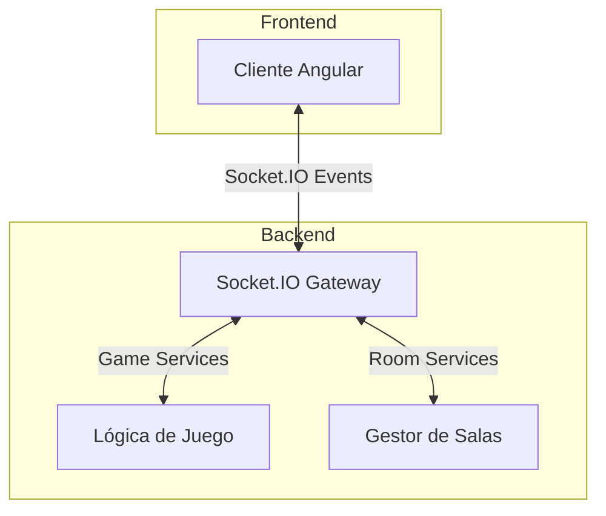

El sistema sigue una arquitectura cliente-servidor clásica, desacoplada mediante comunicación por WebSockets para la transmisión de eventos en tiempo real.

## Diagrama de Alto Nivel

## Componentes Principales

### 1. Backend (Game Master)

El backend actúa como la autoridad central del estado del juego. No confiamos en la validación del cliente.

-   **Responsabilidades**:
    -   Validar que los movimientos (jugar carta, descartar) sean legales.
    -   Mantener el estado "público" (tableros, descartes) y "privado" (mano del jugador) de cada partida.
    -   Gestionar el ciclo de vida de las salas (creación, unión, finalización).
-   **Tecnologías**: Node.js, Express, Socket.IO, TypeScript.

### 2. Frontend (Cliente)

El frontend evita la lógica de reglas de negocio y se enfoca en la experiencia de usuario, la visualización de datos y la interacción en tiempo real.

-   **Responsabilidades**:
    -   Enviar intenciones del usuario (ej: `game:play_card`).
    -   Reaccionar a actualizaciones de estado (`game:state`) para redibujar el tablero.
    -   Animaciones y feedback visual.
-   **Tecnologías**: Angular (Latest), Socket.IO.

## Flujo de Datos

1.  El usuario realiza una acción en el Frontend.
2.  Frontend emite un evento (ej: `game:draw`) al Backend.
3.  Backend valida la acción:
    -   ¿Es el turno del jugador?
    -   ¿Tiene la carta?
    -   ¿Es un movimiento válido según las reglas?
4.  Si es válido:
    -   Backend actualiza el estado del juego en memoria.
    -   Backend emite `game:state` a **todos** los clientes de la sala con la nueva información pública.
    -   Backend emite `game:hand` **solo** al jugador que actuó (o a afectados) con su nueva mano.
5.  Si es inválido:
    -   Backend emite `game:error` al socket origen con el motivo del rechazo.
