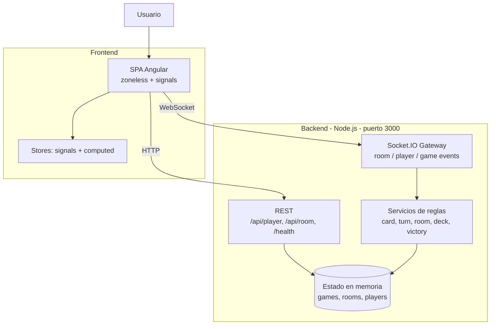

El sistema es **cliente-servidor** con un backend que actúa como autoridad absoluta del estado del juego. El frontend **no** valida reglas: solo envía intenciones y renderiza lo que el servidor emite. La comunicación en tiempo real va por **Socket.IO** (WebSocket); el **REST** solo cubre el arranque (salas y jugadores).

## Diagrama de alto nivel

Un solo **puerto (3000)** sirve HTTP y WebSockets a la vez; el frontend (puerto 4200) solo necesita apuntar ahí.

## Componentes principales

### Backend (Game Master)

Autoridad central del estado. No se confía en la validación del cliente.

- **Responsabilidades**:
  - Validar que cada jugada (robar, jugar, descartar, terminar turno) sea legal y de turno.
  - Mantener el estado **público** (tableros, mazo/descarte, turno) y **privado** (mano de cada jugador) por partida.
  - Gestionar el ciclo de vida de salas (crear, unirse, salir, config, host) y partidas (arranque, fin por victoria/abandono/inactividad).
  - Emitir eventos: `game:state` a la sala, `game:hand` solo a quien le afecta, `game:error` al origen del fallo.
- **Tecnologías**: Node.js, TypeScript (ESM), Express, Socket.IO, Jest.
- Detalle en [Arquitectura del backend](/guides/backend-architecture).

### Frontend (Cliente)

Se enfoca en UX y en reflejar el estado en tiempo real; no contiene reglas de negocio.

- **Responsabilidades**:
  - Enviar intenciones (`game:start`, `game:draw`, `game:play-card`, `game:discard`, `game:end-turn`).
  - Reaccionar a `game:state` / `game:hand` actualizando señales y redibujando el tablero.
  - Persistir la identidad del jugador y la sala actual en `localStorage` (para reconectar).
  - Experiencia: drag & drop de cartas, turnos con cuenta atrás, historial, PWA.
- **Tecnologías**: Angular (zoneless, signals), socket.io-client, Jest.
- Detalle en [Arquitectura del frontend](/guides/frontend-architecture).

## Flujo de datos (una acción de juego)

1. El usuario actúa en el frontend (p. ej. arrastra un virus a un órgano rival).
2. El frontend emite `game:play-card` con `{ roomId, cardId, target }`.
3. El backend valida: ¿estás en la sala? ¿es tu turno? ¿tienes la carta? ¿es un objetivo legal según el color/estado?
4. **Si es válido**:
   - Actualiza el estado en memoria.
   - Emite `game:state` a **todos** los de la sala (nueva información pública).
   - Emite `game:hand` **solo** al jugador afectado (o a todos en casos como *Guantes de Látex*).
5. **Si es inválido**:
   - Emite `game:error` al socket de origen con `{ code, message }`.

Las manos privadas **nunca** se emiten a la sala: solo como unicast a su propietario.

## Decisiones de diseño

| Decisión | Motivo |
| --- | --- |
| Autoridad en el backend | Impide trampa por cliente; el servidor decide si una jugada es legal. |
| Estado en memoria | Simplicidad para desarrollo/multijugador local; fácil de testear (funciones puras `GameState → resultado`). |
| WebSocket para juego, REST para arranque | El juego es en tiempo real; las consultas iniciales (salas, jugador) encajan mejor en HTTP. |
| Zoneless + signals (frontend) | Reactividad sin `zone.js`; el cambio de detección lo dispara la mutación de señales. |
| Eventos con constantes compartidas | `GAME_CONSTANTS`/`ROOM_CONSTANTS`/`PLAYER_CONSTANTS` evitan cadenas sueltas en ambos lados. |

## Enlaces

- [Reglas y mecánicas](/guides/game-mechanics)
- [Arquitectura del frontend](/guides/frontend-architecture)
- [Arquitectura del backend](/guides/backend-architecture)
- [API Socket.IO y REST](/api/socket-io)
- [Glosario](/reference/glossary)
