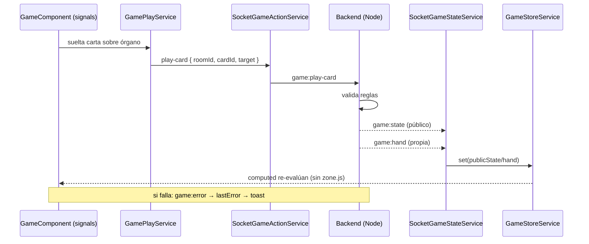

El frontend es una SPA en **Angular 21.2** (Application Builder, sin `zone.js`) que consume el backend por **Socket.IO** (juego) y **REST** (arranque). Es una PWA instalable.

## Stack

| Pieza | Versión | Notas |
| --- | --- | --- |
| Angular (core/router/forms) | 21.2.0 | Zona desactivada con `provideZonelessChangeDetection()` |
| @angular/cdk | 21.2.0 | Drag & drop de cartas |
| socket.io-client | 4.8.x | Transporte WebSocket |
| rxjs | 7.8 | Solo para `HttpClient` (streams), no para estado |
| Jest + jest-preset-angular | 30 / 16 | 743 tests |
| Playwright | 1.58 | E2E |

> **Sin `zone.js`**: el cambio de detección lo dispara Angular directamente al modificar *signals*. Por eso el estado se modela con señales y `computed()`, no con observables de UI.

## Estructura del proyecto

```text
src/app
├── app.config.ts        # bootstrap: zoneless, router, service worker
├── app.routes.ts        # rutas lazy por feature
├── app.ts / app.html    # shell de la app
├── components/          # theme-toggle (global)
├── core/                # dominio compartido (singleton, sin importar features)
│   ├── components/svg-sprite/   # SVGs de órganos, tratamientos, modificadores y UI
│   ├── constants/               # nombres de eventos (game/player/room)
│   ├── models/                  # Player, Room, Card, Game, GameState, acciones
│   └── services/
│       ├── api/                 # REST: api.player.service, api.room.service
│       ├── socket/              # conexión + sockets de room/player/game
│       │   └── game/            # action, listener y state del juego
│       ├── game/                # navegación, jugadas y UI de partida
│       ├── game-store.service.ts
│       ├── room-store.service.ts
│       ├── drag-drop.service.ts
│       ├── pwa.service.ts
│       ├── theme.service.ts
│       └── timer-sound.service.ts
├── features/            # páginas (código lazy)
│   ├── home/            # nombre de jugador, entrar/jugar
│   ├── room-list/       # crear sala, listar, unirse
│   ├── room/            # lobby: jugadores, config, timer, entrar
│   └── game/            # tablero, mano, turno, historial, ganador
└── shared/              # components reutilizables (confirm-modal, pwa-modal, card-icon)
```

## Bootstrap (`app.config.ts`)

```ts
providers: [
  provideBrowserGlobalErrorListeners(),
  provideZonelessChangeDetection(),          // sin zone.js
  provideRouter(routes),                     // rutas lazy
  provideServiceWorker('ngsw-worker.js', {   // PWA solo en producción
    enabled: !isDevMode(),
    registrationStrategy: 'registerWhenStable:30000',
  }),
];
```

## Rutas (lazy loading)

Cada página carga su componente bajo demanda (`loadComponent`):

| Ruta | Componente | Qué hace |
| --- | --- | --- |
| `home` | `HomeComponent` | Pedir nombre de jugador (crea/actualiza por REST) y decidir: crear sala o jugar en `room-list`. |
| `room-list` | `RoomListComponent` | Listar salas públicas, crear sala, unirse. |
| `room/:id` | `RoomComponent` | Lobby: jugadores, configuración (modo/timer), timer de sala, botón *Entrar a jugar*. |
| `game/:id` | `GameComponent` | Partida: tablero, mano, turno, historial, pantalla de ganador. |
| `**` | → `home` | Redirección por defecto. |

## `core`: servicios y estado

### Conexión y transporte

| Servicio | Responsabilidad |
| --- | --- |
| `SocketService` | Crea la única conexión `io(environment.socketUrl, { transports: ['websocket'] })`, expone `connected` (signal) y, al reconectar, restaura la sesión emitiendo `player:reconnect` con el id guardado en `localStorage`. |
| `SocketPlayerService` | Eventos de identidad (`player:identify`, `player:reconnect`, `player:identified`). |
| `SocketRoomService` | Eventos de lobby: `room:new`, `room:join`, `room:getAll`, `room:leave`, `room:config:update` y sus respuestas. |
| `SocketGameStateService` | Suscripción a `game:started` / `game:state` / `game:hand` / `game:end` → actualiza señales de estado. |
| `SocketGameListenerService` | Suscribe los handlers de eventos de juego y los deriva al store/acciones. |
| `SocketGameActionService` | Emite las acciones del cliente: `game:start`, `game:draw`, `game:play-card`, `game:discard`, `game:end-turn`. |
| `ApiPlayerService` | REST de jugadores (`POST/GET/PUT /api/player`) + persistencia en `localStorage` (signals). |
| `ApiRoomService` | REST de salas (`GET /api/room`, `GET /api/room/:id`) + sala actual en `localStorage`. |

> Crear sala y unirse **no** van por REST: es siempre Socket.IO (ver [Referencia API](/api/socket-io)).

### Stores (estado observable con signals)

| Store | Señales principales |
| --- | --- |
| `RoomStoreService` | `roomList`, `currentRoom` (con `computed` para `isHost`, `canStart`, etc.) |
| `GameStoreService` | `publicState`, `hand`, `lastError`, `winner` + selectores `computed` (`isMyTurn`, `isHost`, `myPlayer`...) |

Los stores exponen solo lectura (`asReadonly()`); las mutaciones las hacen los servicios de socket/acción.

### Servicios de juego y utilidades

| Servicio | Responsabilidad |
| --- | --- |
| `GameNavigationService` | Navegación entre lobby y partida (rota `room/:id` ↔ `game/:id`), efectos de limpieza. |
| `GamePlayService` | Resuelve la jugada del usuario (drag & drop / clic) → el `target` correcto por tipo de carta → `SocketGameActionService`. |
| `GameUiService` | Estado de UI de partida: historial abierto, modal de salida, errores temporales. |
| `DragDropService` | Drag & drop de cartas sobre órganos (CDK). |
| `TimerSoundService` | Sonidos del timer/turno (running, warning, critical) + sonidos de turno y ganador, con mute. |
| `ThemeService` | Tema claro/oscuro (signal + `effect`), persistido en `localStorage` (`virus-theme-mode`). |
| `PwaService` | Detecta actualizaciones del service worker (`SwUpdate`, `updateAvailable`) y el prompt de instalación (`isInstallable`). |

### Modelos

`core/models` refleja los tipos del backend: `Player`, `Room`, `Card`, `OrganOnBoard`, `PublicGameState`, `HistoryEntry` y los `*Target` de jugada (`SimpleTarget`, `TransplantTarget`, `ContagionTargets`, ...). Son la fuente de verdad del cliente.

## Features (páginas)

| Feature | Componentes principales |
| --- | --- |
| `home` | `greeting` (nombre de jugador), `join-card` (crear/unirse), `logo`. |
| `room-list` | `room-creation` (visibilidad), `room-item` (tarjeta de sala), `room-join`, `room-logout`, `room-player`. |
| `room` | `room-top` (cabecera/salir), `room-players` (lista + host), `room-config` (modo base/Halloween, timer 30/60/90/120), `room-timer` (cuenta atrás de lobby), `room-enter` (botón iniciar, solo host). |
| `game` | `game-board` (tablero de cada jugador + cartas adheridas), `game-hand` (mano propia + drag & drop), `game-turn` (cuenta atrás del turno), `game-action-feed` (última jugada), `game-history` (historial completo), `game-winner`, `game-empty`, `game-error`. |

Los componentes de `game` consumen `GameStoreService`; los de `room` y `room-list`, `RoomStoreService`. Ningún componente importa otro feature (solo `core`/`shared`).

## Flujo de datos (una jugada)



En resumen: **eventos → señales → `computed` → plantilla**. No hay `Subject` ni `BehaviorSubject` en el camino de la UI.

## Testing

- `pnpm test`: **Jest** + `jest-preset-angular` (743 tests), entorno `jsdom`.
- Componentes se prueban con TestingModule de Angular; los servicios de socket mockan el `Socket` de `socket.io-client`.
- E2E con **Playwright** (`@playwright/test`).

## Enlaces

- [Arquitectura del backend](/guides/backend-architecture)
- [API Socket.IO y REST](/api/socket-io)
- [Testing](/guides/testing)

